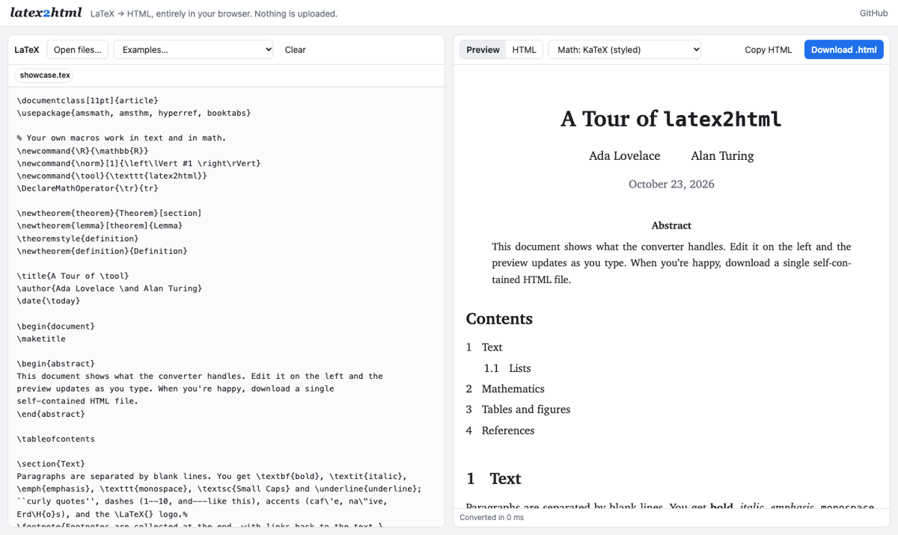

# latex2html

Convert LaTeX documents to clean, standalone HTML — right in your browser.

**Try it: <https://ibipul.github.io/latex2html/>**

Paste LaTeX or open a `.tex` file, see the result as you type, and download a
single HTML file. Everything runs locally in the page: nothing is installed and
your document is never uploaded anywhere.



## Using the web app

1. Open <https://ibipul.github.io/latex2html/>.
2. Paste LaTeX into the left pane, or click **Open files…** (or drag files onto
   the pane). You can pick several files at once: the main `.tex` file, any
   files it `\input`s, and the images it uses. Images are embedded in the output.
3. Check the preview. The status bar lists anything that couldn't be converted,
   such as an unknown command or a missing image.
4. Click **Download .html** (or **Copy HTML**).

**Math output** has two choices:

- **KaTeX (styled)** — the best-looking math. The HTML file links KaTeX's
  stylesheet from a CDN, so it needs an internet connection when viewed.
- **MathML** — math is written as MathML, which modern browsers render
  natively. The file has no external dependencies at all.

Your text is kept in the browser's local storage, so a reload doesn't lose it.

## What it supports

| Area | Supported |
| --- | --- |
| Document | `\title`, `\author` (with `\and`), `\date`, `\maketitle`, `abstract`, `\tableofcontents`, `\appendix` |
| Structure | `\part` … `\subparagraph` (numbered and starred), paragraphs, `\\`, `\newline` |
| Text | `\textbf`, `\textit`, `\emph`, `\texttt`, `\textsc`, `\underline`, `\bfseries`-style declarations, sizes, `\textcolor`/`\color`, accents (`\'e`, `\"o`, `\c{c}` …), quotes, dashes, `~`, common symbols, `\TeX`/`\LaTeX` |
| Lists | `itemize`, `enumerate` (nested, `\item[label]`), `description` |
| Math | `$…$`, `\(…\)`, `$$…$$`, `\[…\]`, `equation`, `align`, `gather`, `multline`, `eqnarray`, `alignat` (starred too), `\tag`, `\nonumber` — rendered with [KaTeX](https://katex.org) |
| Tables | `tabular`, `tabular*`, `tabularx`, `longtable`; `l c r p{}` columns, `\|` borders, `\hline`, `\cline`, booktabs rules, `\multicolumn`, `\multirow` |
| Floats | `figure`, `table`, `\caption`, `\includegraphics` (width/height), `minipage`, `subfigure`, `wrapfigure` |
| References | `\label`, `\ref`, `\eqref`, `\autoref`/`\cref`, `\pageref`, `\footnote`, `\cite` with `thebibliography` |
| Theorems | `\newtheorem` (shared counters, numbering within sections), `\theoremstyle`, `proof`; `theorem`, `lemma`, `definition` … work without declaring them |
| Macros | `\newcommand`/`\renewcommand` (with arguments and an optional default), `\def`, `\let`, `\DeclareMathOperator`, `\newenvironment` |
| Code | `verbatim`, `\verb`, `lstlisting`, `minted`, `\lstinline` |
| Files | `\input`, `\include` (from files you open alongside the main file) |
| Other | `center`, `flushleft`, `flushright`, `quote`, `quotation`, `verse`, `multicols`, `\href`, `\url` |

Commands that only affect page layout (`\usepackage`, `\geometry`,
`\vspace`, `\newpage`, …) are ignored silently. Anything else the converter
doesn't know is reported as a warning, and the text inside its braces is kept
so no content disappears.

**Not supported:** BibTeX/biblatex (`\bibliography{refs}`; paste a
`thebibliography` environment instead), TikZ and other drawing packages, PDF
or EPS images (convert them to PNG or SVG), and per-line numbers in `align`
(the whole block gets one number). If a document defines `\title` but never
calls `\maketitle`, the title is still shown.

## Command line

The same converter runs in Node.js 18 or later:

```sh
git clone https://github.com/ibipul/latex2html.git
cd latex2html
npm install                       # installs KaTeX for math rendering
node bin/latex2html.js examples/turing.tex -o turing.html
```

Options:

```
latex2html [input.tex] [-o output.html] [--mathml] [--fragment]

  -o, --output FILE  write to FILE (default: standard output)
  --mathml           write math as MathML only (no stylesheet needed)
  --fragment         write only the converted body, not a full HTML page
```

With no input file it reads standard input. `\input` files are read relative to
the input file, and image paths are kept as they are, so put the HTML next to
the images.

## Using it as a library

`src/latex2html.js` is a dependency-free ES module that works in browsers and
Node:

```js
import katex from 'katex';
import { convert, renderDocument } from './src/latex2html.js';

const result = convert(latexSource, {
  // Optional. Without it, math is kept as escaped TeX.
  renderMath: (tex, displayMode) => katex.renderToString(tex, { displayMode, throwOnError: true }),
  // Optional. Text for \input, URLs or data: URLs for \includegraphics.
  files: { 'chapter1.tex': '...', 'plot.png': 'data:image/png;base64,...' },
});

result.body;      // converted HTML
result.title;     // plain-text title
result.warnings;  // [{ message, count }]
renderDocument(result, { stylesheets: ['https://cdn.jsdelivr.net/npm/katex@0.16.11/dist/katex.min.css'] });
```

## Development

There is no build step. To run the web app locally, serve the folder (ES
modules don't load from `file://`):

```sh
python3 -m http.server 8000      # then open http://localhost:8000
npm test                         # runs the test suite (node --test)
```

```
index.html, app/       the web app
src/latex2html.js      the converter
bin/latex2html.js      the command-line tool
examples/              sample documents (shown in the app's Examples menu)
test/                  tests
legacy/                the original flex/bison implementation
```

Pushing to `master` runs the tests and publishes the site to GitHub Pages
(`.github/workflows/pages.yml`).

## History

This started as a second-year Compiler Design course assignment (taught by
Prof. Mandar Mitra): a LaTeX-to-HTML translator built with flex and bison. That
version is preserved in [`legacy/`](legacy/). The current converter is a
rewrite in JavaScript, so it can run in the browser and handle a much wider
range of documents.

## License

GPL-2.0. See [LICENSE](LICENSE).

Author: Bipul Islam
